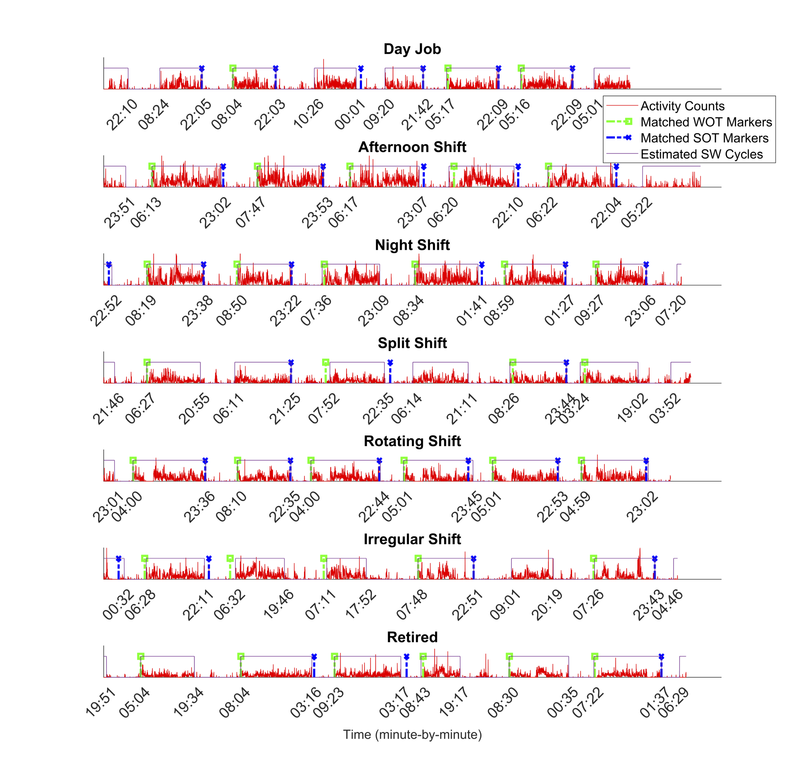

### [Home](/) · [Research](/Research.html) · [Software](/Tools.html) · [Publications](https://scholar.google.com/citations?user=x0SyQn8AAAAJ&hl=en) · [Teaching](/Teaching.html) · [Notes](/Notes.html)
{: .top-nav }

---

[← All software](/Tools.html)

# CircaCP

*Sleep and circadian metrics estimation from actigraphy data*

CircaCP provides an unsupervised approach to detecting sleep–wake cycles in unlabeled actigraphy data. It combines a robust cosinor model with change point detection to estimate sleep and wake onset times.

[Open Shiny app](https://shanshan-chen.shinyapps.io/circacp_r_shiny/) · [R package on CRAN](https://cran.r-project.org/package=CircaCP) · [R source code](https://github.com/ShanshanChen-Biostat/CircaCP-CRAN) · [MATLAB toolbox](https://github.com/ShanshanChen-Biostat/CircaCP)

## What it supports

- Estimation of sleep and wake onset times from actigraphy sequences.
- Estimation of circadian rhythm metrics, including mesor, phasor, interdaily stability, and intradaily variability.
- Actigraphy quality screening, cosinor modeling, and parametric change point detection.
- Segmentation of long activity sequences for physical activity research.

<figure class="software-figure">

<figcaption>Example CircaCP sleep–wake estimates across different work schedules. This research figure illustrates the method; it is not a screenshot of the Shiny app.</figcaption>
</figure>

## Getting started

For interactive exploration, [launch CircaCP Shiny](https://shanshan-chen.shinyapps.io/circacp_r_shiny/). For an analysis in R, install the package from CRAN:

```r
install.packages("CircaCP")
library(CircaCP)
help(package = "CircaCP")
```

The [CRAN package page](https://cran.r-project.org/package=CircaCP) provides the reference manual and vignettes. The [actigraphy research page](/Actigraphy.html) describes the methodological background and validation.

## Reference

Chen, S. and Sun, X. (2024). *Validating CircaCP: a generic sleep–wake cycle detection algorithm for unlabelled actigraphy data*. Royal Society Open Science, 11, 231468. [doi:10.1098/rsos.231468](https://doi.org/10.1098/rsos.231468).

The algorithm was validated against event markers in the MESA Sleep study. For package-specific citation information, use `citation("CircaCP")` in R.
