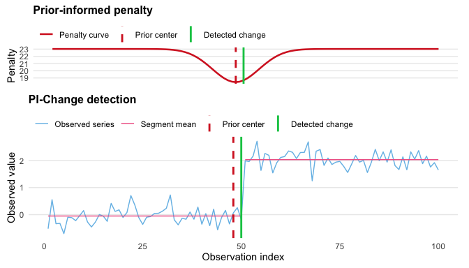

### [Home](/) · [Research](/Research.html) · [Software](/Tools.html) · [Publications](https://scholar.google.com/citations?user=x0SyQn8AAAAJ&hl=en) · [Teaching](/Teaching.html) · [Notes](/Notes.html)
{: .top-nav }

---

[← All software](/Tools.html)

# PiChange

*Change point detection with prior-informed penalties*

PiChange implements a method for detecting multiple change points while incorporating external knowledge about plausible change locations. A time-varying penalty allows prior information to influence segmentation within the PELT dynamic programming framework.

Developed by Jonathon Jacobs and Shanshan Chen.

[R package on CRAN](https://cran.r-project.org/package=PiChange) · [Source code](https://github.com/ShanshanChen-Biostat/PiChange) · [Methods preprint](https://doi.org/10.48550/arXiv.2605.01003)

## How prior information enters the analysis

Prior locations are soft inputs: they lower the penalty for a nearby change without forcing one to occur. Changes remain possible elsewhere in the series. Users explicitly construct and inspect the penalty before fitting the segmentation.

The package supports Gaussian and zero-adjusted gamma segment models, and prior locations can be specified using observation indices or dates. Prior widths are measured in observation positions.

<figure class="software-figure">

<figcaption>Simulated example from the package’s getting-started vignette. The upper panel shows the penalty; the lower panel shows the observed series, fitted segment means, prior center, and detected change.</figcaption>
</figure>

## Getting started

```r
install.packages("PiChange")
library(PiChange)

set.seed(1)
y <- c(rnorm(40, 0, 0.3), rnorm(40, 2, 0.3))

penalty <- construct_penalty(
  n = length(y),
  centers = 40,
  width = 5,
  method = "mbic",
  family = "normal"
)

fit <- pi_change(y, penalty, min_seg_len = 10)
changepoints(fit)
plot(fit)
```

This simulated example follows the package README. For model choices, date-based analyses, and prior-width sensitivity, see `vignette("getting-started", package = "PiChange")` and the documentation on [CRAN](https://cran.r-project.org/package=PiChange).

Prior locations and widths should reflect scientific knowledge. Assess whether conclusions persist over a reasonable range of prior widths.

## Reference

Jacobs, J. and Chen, S. (2026). *Pi-Change: A Prior-Informed Multiple Change Point Detection Algorithm*. [arXiv preprint, doi:10.48550/arXiv.2605.01003](https://doi.org/10.48550/arXiv.2605.01003).

For package-specific citation information, use `citation("PiChange")` in R.
