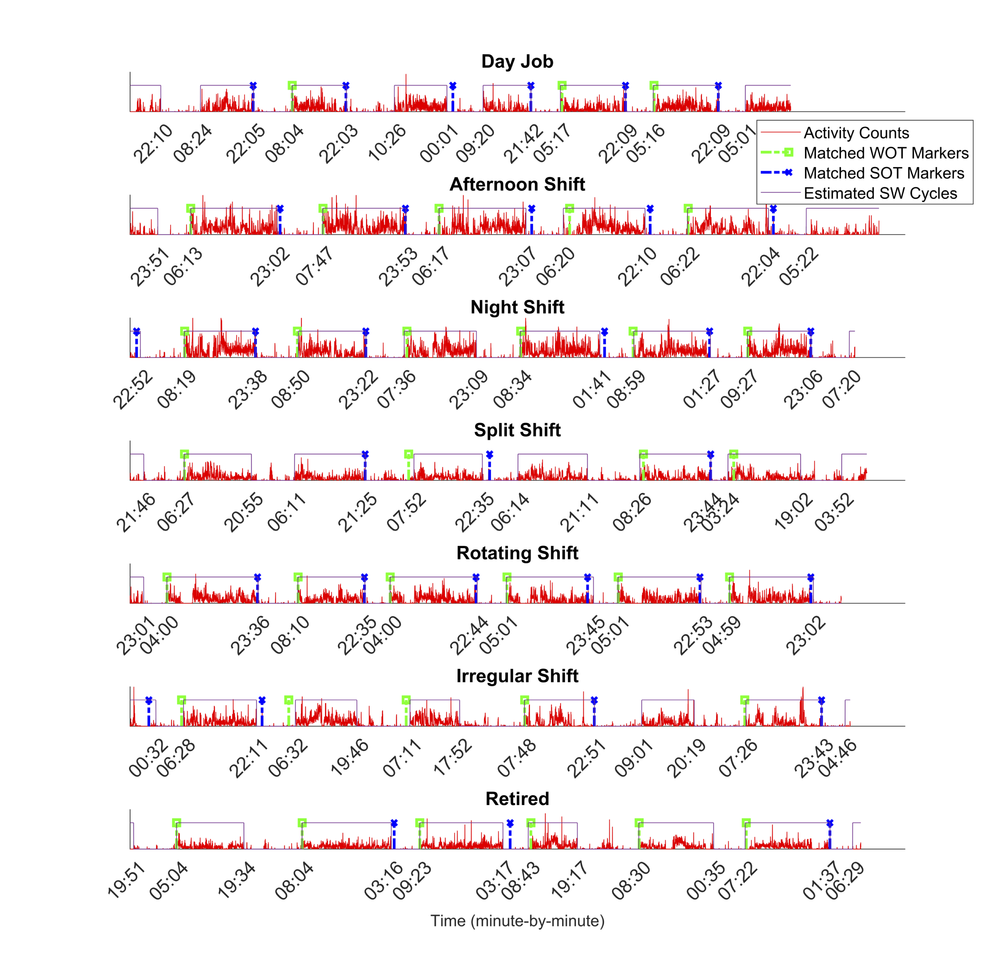
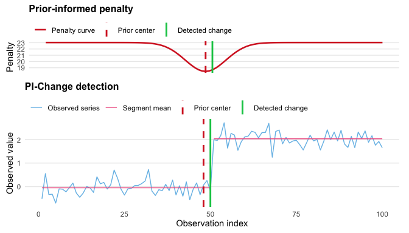

## Software

R packages and interactive applications for actigraphy analysis, change point detection, and multiple sclerosis research.

### [CircaCP](/CircaCP.html)

Estimate sleep–wake cycles and circadian rhythm metrics from actigraphy data. Use the R package for reproducible analyses, or explore wearable activity data with the CircaCP Shiny app.

[Overview & getting started](/CircaCP.html) · [R package](https://cran.r-project.org/package=CircaCP) · [Open Shiny app](https://shanshan-chen.shinyapps.io/circacp_r_shiny/)

### [PiChange](/PiChange.html)

Detect multiple change points while incorporating prior knowledge about plausible change locations through a time-varying penalty.

[Overview & getting started](/PiChange.html) · [R package](https://cran.r-project.org/package=PiChange) · [Source code](https://github.com/ShanshanChen-Biostat/PiChange)

## Multiple sclerosis calculators

<a class="software-thumbnail calculator-thumbnail" href="/MSSS.html" aria-label="About the MSSS calculator">MSSSMultiple Sclerosis Severity Score</a>

### [MSSS Calculator](/MSSS.html)

Explore disability severity in the context of disease duration using the Multiple Sclerosis Severity Score (MSSS).

[About the calculator](/MSSS.html) · [Open MSSS calculator](https://shanshan-chen.shinyapps.io/msss-calculator/)

<a class="software-thumbnail calculator-thumbnail" href="/P-MSSS.html" aria-label="About the P-MSSS calculator">P-MSSSPatient-derived MS Severity Score</a>

### [P-MSSS Calculator](/P-MSSS.html)

Explore the patient-derived Multiple Sclerosis Severity Score (P-MSSS), which places patient-reported disability in the context of disease duration.

[About the calculator](/P-MSSS.html) · [Open P-MSSS calculator](https://shanshan-chen.shinyapps.io/p-msss_calculator/)

